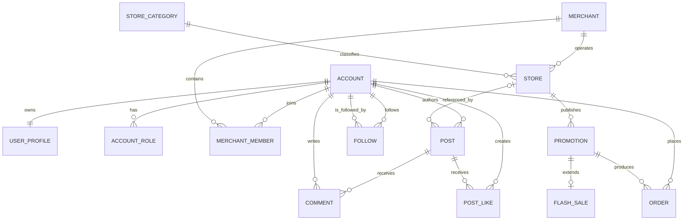

# CampusHub 领域模型

Phase7S提取merchant的门店分类查询切片，Controller仅依赖查询用例，缓存JSON与MyBatis查询由适配器承担。ShopType实体/响应和Mapper暂留原包，保留tb_shop_type、公开GET及旧缓存；并未完成Merchant/Store全模块迁移或新增分类管理。范围见[7S记录](refactor/41-phase-7s-shop-type-module.md)。

Phase7R将签到迁入 `engagement` 首个业务切片：api→纯Java应用服务→存储端口→Redis适配器，移出登录服务；保留原月度Bitmap、JVM默认时区、当天未签为0与不跨月累计的语义。没有新增实体、表、积分、补签或通知；其他模块仍待渐进拆分。范围见[7R记录](refactor/40-phase-7r-check-in-module.md)。

Phase7Q补[按动态分页读取回复隐藏审计](refactor/39-phase-7q-reply-audit-pages.md)：ADMIN只读V013元数据，按审计ID倒序游标，默认20/最大50，多取一行判后页；缺当前业务行仍可读保留审计。V014仅候选(blog_id,id)索引，不回填或修复历史，不承诺性能或跨页冻结。V008根审计仍独立；学习见[回复审计游标](learning/reply-hide-audit-pagination.md)。

Phase7P补[单条回复隐藏审计](refactor/38-phase-7p-reply-audit-query.md)：ADMIN只读V013保留的九字段元数据，不join当前回复/根/动态/操作人；五个ID为字符串，缺记录404，不从旧状态推断历史。V008根审计读取仍独立；无新DDL、分页、导出或恢复。学习见[回复审计读取](learning/reply-hide-audit-query.md)，验证以本阶段记录为准。

Phase7N增加[发布请求账本](refactor/36-phase-7n-blog-publication-keys.md)：V012以当前用户/可选请求编号记录有效创建请求摘要与原成功ID，与动态/Feed意图同事务。账本不是正文历史或当前可见性，保留成功编号，不随撤回删除；无编号创建仍可能重复，不代表全部写接口都幂等。

Phase 7O 增加[ADMIN 隐藏直接回复](refactor/37-phase-7o-direct-reply-moderation.md)：合法直接回复0→2、动态comments减一和独立V013审计同事务；根隐藏/撤回不阻止管理该回复。选定本机验证已完成。

Phase7M增加[动态Feed投递意图](refactor/35-phase-7m-blog-feed-delivery.md)：V011按post/recipient记录本次DB关注快照及固定score，与动态同事务；后台确认前保留，确认后删除。它不是永久投递历史、全Feed重建或读消息状态，不改变既有Post/Follow生命周期；以下Phase1A的“应可重建”仍是目标，不是本阶段已实现事实。

Phase 7K 状态：[作者本人动态逻辑撤回](refactor/33-phase-7k-post-author-withdrawal.md)新增V010 `withdrawn`标记，保留原文/关联/评论/计数/审计和Redis；详情、互动新增与公开列表尊重可见性。无物理删除、恢复或动态审核；旧应用不可直接回退。以下Phase1A及各阶段段落是设计/演进历史。

## 1 文档目的与阶段结论

本文定义 CampusHub 从点评教学项目演进为校园生活与商户服务平台时采用的统一业务语言、实体关系、核心规则、权限边界和旧数据映射。它是 Phase 1A 的设计结论，不在本阶段修改 Java 类、数据库表、接口或运行行为。

后续状态：本文保留 Phase 1A 历史设计；Phase 7A 已按[阶段记录](refactor/23-phase-7a-campus-posts.md)落地普通动态的可选门店关联（V006 + POST /blog）。Phase 7B 已按[阶段记录](refactor/24-phase-7b-comments.md)落地一级评论（V007），Phase 7C 增加[一层直接回复](refactor/25-phase-7c-comment-replies.md)，7D/7E 增加作者本人逻辑撤回，7F 增加[ADMIN 隐藏一级评论及审计](refactor/28-phase-7f-comment-moderation.md)（V008），7G 单条读取，7H 按动态分页读取（V009）；7H 实现与选定本轮验证完成。Phase 7I 已实现 POST /blog 对无关联门店纯文字动态的 images 归一化语义，不新增结构；选定本轮验证完成，见[阶段记录](refactor/31-phase-7i-text-only-campus-posts.md)。Phase 7J 已实现既有动态的作者本人完整替换编辑：仅允许 USER/MERCHANT/ADMIN 编辑本人动态，ADMIN 不覆盖作者限制；门店关联保持存量值不变，不新增结构，状态见[阶段记录](refactor/32-phase-7j-post-author-edit.md)。Phase 7O 已实现 ADMIN 隐藏合法直接回复并以 V013 独立记审计；本阶段选定本机验证已完成。当前仍未实现多级回复、恢复、举报工作流、通知、点赞持久化和完整管理后台。

CampusHub 继续采用模块化单体。第一版按单校园场景设计，不引入多租户或 `Campus` 表；当系统出现跨校数据隔离、不同校区运营或独立管理员等真实需求时，再增加校园维度。当前重点是把“账号、商户主体、门店、内容、活动和订单”分清，而不是机械替换 `Shop`、`Blog`、`Voucher` 等名称。

关键决策：

1. `User` 是登录账号；普通学生、商户操作员和管理员共用账号体系，一个账号可以拥有多个角色。
2. `Merchant` 是经营主体，不是登录账号，也不等同于门店；商户操作员通过成员关系管理其所属商户和门店。
3. 当前 `Shop` 的业务含义是 `Store`。迁移初期保留 `tb_shop` 和旧类名，避免把领域改名与正确性修复混在一起。
4. 当前 `Blog` 演进为 `Post`。动态由用户发布，可以关联门店；普通校园动态未来允许不关联门店。
5. 当前 `Voucher` 演进为 `Promotion`，`SeckillVoucher` 是限量活动 `FlashSale` 的扩展，订单只引用活动标识。
6. MySQL 保存业务事实；Redis 中的 Feed、点赞排行、GEO、签到位图和活动预扣是索引、投影或运行态，不能被描述为全部业务事实的唯一来源。

## 2 统一领域词汇

| 领域对象 | 含义 | 当前映射 | 本阶段处理 |
| --- | --- | --- | --- |
| Account | 可登录账号及账号状态 | `User` 的认证字段、`tb_user` | 保留旧名，后续补状态与角色 |
| UserProfile | 昵称、头像、个人资料与活跃信息 | `User` 的展示字段、`UserInfo`、`tb_user_info` | 保留；修正错误字段类型时使用迁移脚本 |
| Role | `USER`、`MERCHANT`、`ADMIN` 权限集合 | 不存在 | Phase 2 增加，不塞入现有布尔字段 |
| Merchant | 校园周边经营主体 | 不存在 | 商户后台落地前增加 |
| MerchantMember | 账号与商户的成员及管理关系 | 不存在 | 与 Merchant 同阶段增加 |
| Store | 用户可浏览、搜索和到店消费的门店 | `Shop`、`tb_shop` | 先保持表和接口兼容，Phase 1C 再迁移代码身份 |
| StoreCategory | 门店分类 | `ShopType`、`tb_shop_type` | 保留语义，后续改名 |
| Post | 校园动态或与门店关联的内容 | `Blog`、`tb_blog` | 先修 Feed，再迁移名称与请求响应边界 |
| Comment | 对动态的一级评论及一层直接回复 | `BlogComments`、`tb_blog_comments`；根隐藏审计 `tb_blog_comment_hide_audit`，回复隐藏审计 `tb_blog_reply_hide_audit` | 7B/7C 创建和可见列表读取，7D/7E 作者本人逻辑撤回，7F ADMIN 隐藏一级评论并记根审计，7O ADMIN 隐藏直接回复并记独立审计；多级回复/级联或物理删除/恢复/举报工作流待后续设计 |
| Follow | 用户对用户的关注关系 | `Follow`、`tb_follow` | MySQL 为事实来源，Redis 仅加速 |
| PostLike | 用户对动态的点赞关系 | Redis ZSet 和 `tb_blog.liked` 计数 | 后续增加持久化关系，计数作为派生值 |
| FeedEntry | 用户 Feed 收件箱中的动态投影 | Redis ZSet | 不是独立业务事实，可由关注与动态重建 |
| Promotion | 门店发布的优惠或活动规则 | `Voucher`、`tb_voucher` | 先保留表结构，后续明确状态机 |
| FlashSale | Promotion 的限时限量规则 | `SeckillVoucher`、`tb_seckill_voucher` | 保留一对一扩展方式 |
| Order | 用户参与活动后的订单结果 | `VoucherOrder`、`tb_voucher_order` | 补幂等、状态与恢复能力后再扩展 |
| CheckIn | 用户每日签到行为 | Redis Bitmap；`tb_sign` 未被代码使用 | 第一版继续用 Bitmap，明确其数据保留策略后再决定是否落库 |
| Notification | 面向用户或商户的通知 | 不存在 | 仅保留模块边界，有明确通知场景后建模 |

Phase 1A 审计时，`UserInfo.level` 的 Java Boolean 与数据库 0 到 9 的等级含义不符；`BlogComments.status` 也用 Boolean 承载三种状态。这是旧模型问题；后者已在 7B 改为 Integer 保留 0/1/2/NULL，7D/7E 增加 3（作者撤回直接回复/一级评论），不把历史审计描述当成当前类型。

## 3 核心实体与关系

### 3.1 身份与账号

`Account` 负责认证标识、凭据、状态和角色，不承载商户资料。默认注册账号拥有 `USER` 角色；成为商户操作员需要平台审核后的有效 `MerchantMember`，同时拥有 `MERCHANT` 角色。管理员角色不能通过普通注册或公开接口自行获得。

账号状态至少区分 `ACTIVE` 和 `DISABLED`。禁用账号不能继续创建会话或执行受保护操作，已有会话需要能够失效。角色用于粗粒度准入，资源归属用于细粒度授权，两者缺一不可。

`UserProfile` 与 Account 一对一。昵称、头像、介绍、生日等属于资料；关注数、粉丝数、积分和等级是派生或活跃体系数据，不应参与认证决策。

### 3.2 商户与门店

`Merchant` 表示经营主体，`Store` 表示具体经营地点。一个 Merchant 可以经营多个 Store，一个 Store 在完成迁移后必须归属于一个 Merchant。商户成员关系至少包含 `OWNER` 和 `OPERATOR` 两种成员角色，以及有效状态。

迁移前的 `tb_shop` 没有所有者。历史门店先标记为平台托管，完成商户认领或管理员分配后再建立归属；不能根据发布过某条动态或创建过某张优惠券来推断所有权。

Store 保存名称、分类、图片、地址、坐标、营业时间和展示统计。评分、销量和评论数属于可重算的展示数据，不作为授权或交易判断依据。

### 3.3 内容与社交

`Post` 必须有作者。用户动态可以不关联门店；探店内容和商户内容可以关联一个 Store。当前 `tb_blog.images` 用既有字符串列承载图片引用；Phase 7I 语义中，无关联门店的纯文字动态把缺失或 `String.trim()` 后为空白的图片值归一化为非 null 空字符串 `""`，关联门店内容仍须有非空白图片。该语义不引入新字段或迁移，且归一化前仍检查原始值最多 2048 个 Java UTF-16 单元。兼容验证及应用实现已在选定本轮范围完成，见[阶段记录](refactor/31-phase-7i-text-only-campus-posts.md)。Phase 1A 当时的 `tb_blog.shop_id NOT NULL` 约束已由 7A 的 V006 放宽；既有部署仍须按其备份、迁移和兼容说明处理。

第一版把校园动态和门店体验统一为 Post，通过是否关联 Store 和内容类型区分，不立即增加独立 Review 聚合。当前没有结构化星级评价、消费凭证或“一次订单一次评价”的实现；若这些规则成为真实需求，再从 Post 中拆出 Review，不能仅凭 `tb_shop.score` 宣称已经具备评价系统。

`Comment` 属于一个 Post 并由一个账号创建。一级评论没有父评论；回复必须引用同一 Post 下存在且可见的评论。评论状态采用枚举语义，例如 `NORMAL`、`REPORTED`、`HIDDEN`，不能继续用 Boolean 表达三种状态。

7B 的一级评论写入 `parent_id=answer_id=0`；7C 的直接回复只接受正常一级评论为目标，blog_id 从根评论派生，parent_id=answer_id=根评论 ID，作者来自会话，liked/status=0。两类列表独立按 ID 倒序游标查询，回复不混入一级列表。写回复先锁动态后锁根评论，当前读复核根状态；不实现多级回复，不将旧字段直接视为完整业务能力。

7D 的 `DELETE /blog-comments/replies/{replyId}` 是本人直接回复逻辑撤回：所有角色均只可操作本人符合 parent_id>0、answer_id=parent_id 的 0/3 状态行，要求动态存在，不要求父评论仍存在/可见（包括本人符合格式的旧孤立回复）。先锁动态，再当前读锁回复并复核归属/关系/状态；0→3 和计数递减同事务，3 重复不扣计数。7D阶段没有回复审核；7O新增管理员隐藏，规则见下文。保留原文，无物理删除或恢复。NULL/0 计数下限为 0，不回填历史，不保证聚合等于可见数。规则及回退限制见[回复撤回笔记](learning/direct-reply-withdrawal.md)。

7E 的 `DELETE /blog-comments/{commentId}` 是本人一级评论撤回：作者及 parent_id=answer_id=0、status 0/3、动态存在同时成立。保持相同锁顺序/当前读复核，根 0→3 和减一同事务，重复不扣。保留全部回复行/状态，不级联修改或扣回复数；撤回根从一级列表排除，其下新请求的回复读取/创建为 404，回复作者仍可用 7D 独立撤回。管理员和商户也仅本人，不扩展恢复/回复审核。并发只读快照可能看见旧版本，细节见[一级评论撤回笔记](learning/first-level-comment-withdrawal.md)。

7F 的 `POST /admin/blog-comments/{commentId}/hide` 是独立于 Actuator 管理监听器的 ADMIN 应用端能力。只接受正 Java Long 评论 ID 和非空白 `reason`（最多 255 个 Java UTF-16 单元）；未知 JSON 字段忽略，操作人取登录会话。隐藏只针对存在动态下的正常一级评论，作者不限制；普通 USER/MERCHANT 即使是作者也返回 403。先锁动态，再当前读锁根评论；状态 0→2、动态评论数递减（NULL/0 下限为 0）和写入 V008 审计行在同一事务。任一写入影响行数不是 1 即回滚并返回 422，数据访问异常映射为不含原因的通用 500。只有 status=2 且存在 comment/blog/from=0/to=2 匹配审计行时重复请求才成功，不修改首次操作人/原因、不再次扣数；无匹配审计、status 1/3/NULL、回复、无效关系或缺失动态均为 404。保留根评论原文与全部回复行/状态，不级联或修改回复计数；根从一级列表排除，其下新回复读取/创建为 404，回复作者仍可独立撤回，根作者不能撤回 status=2。V008 不回填旧 status=2 记录；回退应用不恢复状态/计数，保留审计表和数据。审计不是防篡改证据，也没有受保护的导出 API、内容快照、外键或恢复流程。并发 RR 普通读可能看到旧快照；回复创建若先拿到动态锁可能先完成。范围和迁移边界见[7F 阶段记录](refactor/28-phase-7f-comment-moderation.md)。

7G 增加单条审计查询 `GET /admin/blog-comments/{commentId}/hide-audit`，由应用端 ADMIN guard 保护，正 Java Long 参数；匿名、停用或未知角色身份为 401，USER/MERCHANT（包括评论作者或操作人）为 403，非法参数 400，缺失审计 404，数据库错误通用 500。成功返回 `Result.ok` 与八字段白名单 DTO（字符串 ID、reason、Integer 状态和 `LocalDateTime createTime`）。按 V008 审计行独立读取，不关联当前评论/动态/用户，不从当前状态推断历史；参数绑定的普通 SELECT 在 5 秒超时的只读 REPEATABLE READ 事务中执行，不加 `FOR UPDATE`。新事务读取已提交快照，既有 RR 事务可能看到更早快照；不回填历史记录，审计仍非防篡改证据。无状态写、计数变化、列表/导出、恢复、UI 或新迁移。26 项定向、360 项默认统计（4 设计跳过）、43 项显式 MySQL IT、23 组目标 Compose 验证通过；最终提交/审查状态在交付对话报告，见[7G 阶段记录](refactor/29-phase-7g-comment-audit-query.md)。

7H 已增加 `GET /admin/blog-comments/hide-audits/of/blog/{blogId}`，仅 ADMIN 可读，按一个 blog 过滤并使用 `id < beforeId`、`id DESC` 游标及默认 20/最大 50 条分页。每页在只读 REPEATABLE READ 事务中执行参数化普通 SELECT，5 秒查询超时，以 `size+1` lookahead 得到 hasNext；nextBeforeId 仅在还有下一页时取最后返回审计 ID 字符串。审计 DTO 仍为 8 个字段；空/缺失 blog 与无审计统一成功返回空页，不 join 当前业务行。V009 增加候选 `(blog_id,id)` 索引，名字检查可重复执行但不修复同名错误形状，依赖 V008 表先创建；DDL 与行保留已在隔离 MySQL 验证，不代表生产迁移或性能提升。ID 分配次序不是提交顺序，因此各页独立快照，不保证跨页无遗漏/冻结视图，不作 SLA 或性能结论。范围、验证证据与部署约束见[7H 阶段记录](refactor/30-phase-7h-comment-audit-pages.md)。

7O 的 `POST /admin/blog-comments/replies/{replyId}/hide` 是 ADMIN-only 直接回复隐藏入口。reason复用请求DTO：非空白、最多255个Java UTF-16单元；操作人来自会话，成功为200 `Result.ok()`且无data。写事务门禁在任何SQL之前；按候选回复→锁动态→锁同动态规范根（parent_id=answer_id=0，不限根状态）→锁目标回复的顺序，用锁定当前读复核目标。仅接受 parent_id>0、answer_id=parent_id、status=0/2 的直接回复。首次0→2、动态comments按零下限减一、V013插入一条专用审计同事务；任一写入不为1返回422并回滚，DataAccessException转不带cause的通用500。只有status=2且有匹配reply/blog/root、from=0/to=2的本用途审计才重复200，不写、不扣、不覆盖首次操作人/原因；旧status=2无此审计为404。1/3/NULL、非法或多级关系、缺动态/根/回复均404。隐藏或撤回根、已撤回动态下仍能隐藏存在且关系正确的回复。作者不能撤回status=2回复。保留正文、liked、关系、根和兄弟，不级联。计数是写入维护的派生值，不是当前可见行数保证，不回填历史。V013独立表唯一约束reply_id；不加外键、内容快照、TTL、恢复、举报、通知；7O当时没有审计读取，7P单条读取见文首，7G/7H的V008根评论审计API不包含回复审计。部署/回退见[7O记录](refactor/37-phase-7o-direct-reply-moderation.md)，学习见[直接回复隐藏笔记](learning/direct-reply-moderation.md)；选定本机验证已完成。

`Follow` 只表示账号关注账号，禁止自己关注自己；同一 `(follower_id, followee_id)` 只能存在一次。MySQL 保存关系事实，Redis 集合或有序集合只能作为查询加速，结构必须统一。

`PostLike` 规定同一账号对同一 Post 最多存在一条有效点赞关系。`liked` 计数是派生值，不能在关系丢失时仍被视为可靠事实。Redis ZSet 可以保留点赞时间排序，但后续需要持久化关系或明确可恢复的数据策略。

`FeedEntry` 是面向某个账号的收件箱投影。Post 是内容事实，Follow 是订阅事实；Feed 丢失时应能够重建，因此 Feed 不拥有 Post 生命周期。

### 3.4 优惠活动与订单

`Promotion` 归属于 Store，描述标题、规则、金额、类型和发布状态。当前金额继续使用分为单位的整数。活动状态至少区分草稿、有效、下架和过期；过期由时间和状态共同判断，不能只依赖展示字段。

`FlashSale` 与 Promotion 一对一，只保存限时限量规则，例如库存、开始时间、结束时间和资格策略。必须满足开始时间早于结束时间、库存不为负、活动有效期与 Redis key TTL 一致等规则。

`Order` 关联 Account 和 Promotion。当前迁移范围继续采用“一名用户对同一活动最多一单”的规则，并由数据库 `(user_id, voucher_id)` 唯一约束提供最终防线。若未来业务允许多次购买，必须显式引入购买上限或批次模型，不能直接删除唯一约束。

Redis Lua 的成功仅表示请求被受理和库存已预扣，不等于数据库订单已经创建。订单必须能区分受理、创建、支付、核销、取消和退款等状态；当前代码只实际覆盖异步建单的一部分，不把既有状态字段当作完整业务闭环。

### 3.5 签到与通知

第一版签到仍使用按账号和月份分桶的 Redis Bitmap，规则是每个自然日最多签到一次，并能计算截至当天的连续签到天数。是否需要长期审计、补签和积分结算尚未形成真实用例，因此暂不让未使用的 `tb_sign` 成为事实来源。

Notification 只定义为未来独立模块。只有在订单状态、活动结果或商户审核等具体通知用例确定后，才设计通知实体、渠道、已读状态和重试策略；本阶段不为“看起来完整”而创建空表。

## 4 角色与资源权限

下表是目标权限边界，并非全部已实现 API。当前 7D/7E 回复/一级评论逻辑撤回对 USER/MERCHANT/ADMIN 一律仅本人，无商户内容或管理员覆盖；7F 增加 ADMIN 隐藏正常一级评论，7G/7H 已实现该根审计的单条/按动态分页只读，7O 增加 ADMIN 隐藏合法直接回复。7J 已实现作者本人动态编辑，不改变门店关联或计数。动态删除、级联/物理删除、恢复、举报工作流和完整审核后台仍未实现。

| 操作 | 匿名用户 | USER | MERCHANT | ADMIN |
| --- | --- | --- | --- | --- |
| 浏览已发布门店、动态和活动 | 允许 | 允许 | 允许 | 允许 |
| 管理本人资料和会话 | 不允许 | 仅本人 | 仅本人 | 仅本人 |
| 发布普通校园动态、评论、关注和点赞 | 不允许 | 允许 | 允许 | 允许 |
| 编辑动态（7J） | 不允许 | 仅本人 | 仅本人 | 仅本人；无管理员覆盖 |
| 隐藏正常一级评论（7F） | 不允许 | 不允许 | 不允许 | 允许；作者身份不影响管理权限 |
| 隐藏合法直接回复（7O） | 不允许 | 不允许 | 不允许 | 允许；父根可见性不影响该管理操作 |
| 读取隐藏审计（7G根单条/7H根分页/7P回复单条/7Q回复分页） | 不允许 | 不允许 | 不允许 | 只读；须为当前ADMIN，不以原操作人身份代替权限 |
| 签到、参与活动、查看订单 | 不允许 | 仅本人 | 以用户身份仅本人 | 仅管理接口，不能冒充用户下单 |
| 创建或修改门店 | 不允许 | 不允许 | 仅有效成员所属 Merchant 的 Store | 允许审核和平台管理 |
| 创建、上下架活动 | 不允许 | 不允许 | 仅所属 Store | 允许审核和平台管理 |
| 查看商户后台数据 | 不允许 | 不允许 | 仅所属 Merchant 或 Store | 允许平台范围查看 |
| 管理角色、账号状态和商户审核 | 不允许 | 不允许 | 不允许 | 允许 |

权限判断遵循以下顺序：

1. 验证会话有效且账号状态允许操作。
2. 验证账号拥有接口要求的角色。
3. 对资源写操作验证作者、MerchantMember 或 Store 归属。
4. 验证资源当前状态允许该动作，例如已过期活动不能重新抢购。
5. 在应用服务中执行用例，不能只依赖前端隐藏按钮或 Controller 路径配置。

`MERCHANT` 角色只代表账号可以进入商户能力，不代表可以修改全部 Store。`ADMIN` 也应通过独立管理用例操作，不直接复用普通用户接口绕过状态机和审计。

## 5 模块边界与依赖

| 模块 | 负责内容 | 可以依赖 |
| --- | --- | --- |
| identity | Account、UserProfile、Role、会话和账号状态 | shared |
| merchant | Merchant、MerchantMember、Store、StoreCategory 和资源归属 | identity、shared |
| content | Post、Comment、PostLike 和内容审核状态 | identity、merchant 的只读引用、shared |
| social | Follow、FeedEntry 和 Feed 重建 | identity、content 的标识或事件、shared |
| promotion | Promotion、FlashSale、资格和 Redis 活动态 | identity、merchant、shared |
| order | Order、幂等、消费、核销和补偿 | identity、promotion、shared |
| engagement | CheckIn、积分规则和活跃记录 | identity、shared |
| notification | 明确用例后的站内通知及投递状态 | 只消费其他模块公开事件或查询接口 |
| shared | API 错误、日志、配置和通用基础设施 | 不依赖业务模块 |

模块化单体内部优先使用明确的应用服务和标识引用。不得让 Controller 直接调用其他模块的 Mapper，也不得通过互相注入通用 MyBatis-Plus Service 形成循环依赖。只有确实需要异步处理或故障隔离时才使用事件。

## 6 旧模型兼容与迁移顺序

### 6.1 保留兼容

- Phase 1B 修复正确性时继续使用 `com.hmdp`；Phase 1C 已将 Java 根包迁移为 `io.github.frewily.campushub`，旧 Entity 和旧表名继续兼容，避免身份迁移与领域重建互相干扰。
- `tb_shop` 暂时承载 Store，`tb_blog` 暂时承载 Post，`tb_voucher` 暂时承载 Promotion。
- Redis key 和接口路径在替代实现完成验证前保持兼容；迁移时要有读写过渡或明确版本边界。
- 新增数据库约束和字段必须使用可重复执行、可审查的版本化迁移脚本，不能继续只编辑全量 `hmdp.sql`。

### 6.2 后续落地顺序

1. Phase 1B 先修 Feed key、关注 Redis 类型、缓存重建和订单 ACK，并增加关注及订单业务唯一约束。
2. Phase 1C 迁移应用身份、Maven 坐标和根包；不在同一提交创建商户后台。
3. Phase 2 增加账号状态和角色模型，再建立 Merchant、MerchantMember 与 Store 归属，完成历史门店的平台托管和认领迁移。
4. 内容模块实现时放宽普通 Post 的门店关联，并补 Comment 与 PostLike 的事实模型。
5. Phase 3 在 Promotion、FlashSale 和 Order 语义上完善活动时间、资格、可靠消费、补偿和状态查询。

## 7 本阶段不做事项

- 不修改 Java 包名、类名、接口路径或数据库表名。
- 不添加角色、商户、点赞或通知表。
- 不实现 Spring Security、商户后台或管理后台。
- 不选择 RabbitMQ、RocketMQ、Elasticsearch 或微服务架构。
- 不把尚未实现的支付、核销、补偿、通知和多校园能力写成现有功能。
- 不声明任何未经实际压测的 QPS、延迟、并发量或提升比例。

## 8 可验证的阶段出口

- 核心词汇能够映射到现有 Java Entity、数据库表或明确标记为缺失的新概念。
- Merchant 与 Store、Role 与资源归属、Promotion 与 FlashSale 的边界明确。
- USER、MERCHANT、ADMIN 的权限不仅按角色，还包含本人、作者、商户成员和门店归属约束。
- Follow、Feed、点赞、签到和 Redis 活动态明确区分业务事实与查询投影。
- 后续阶段可以按兼容顺序落地，不需要一次性重写现有系统。
